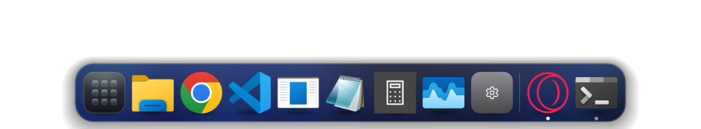
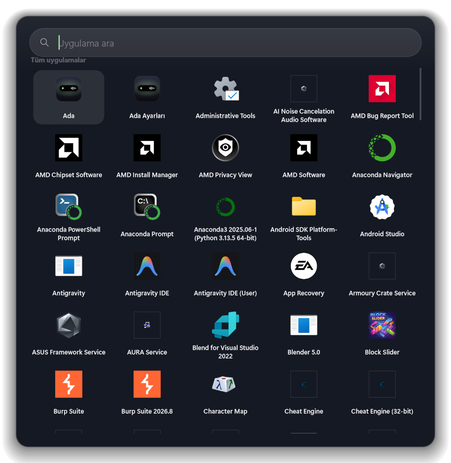
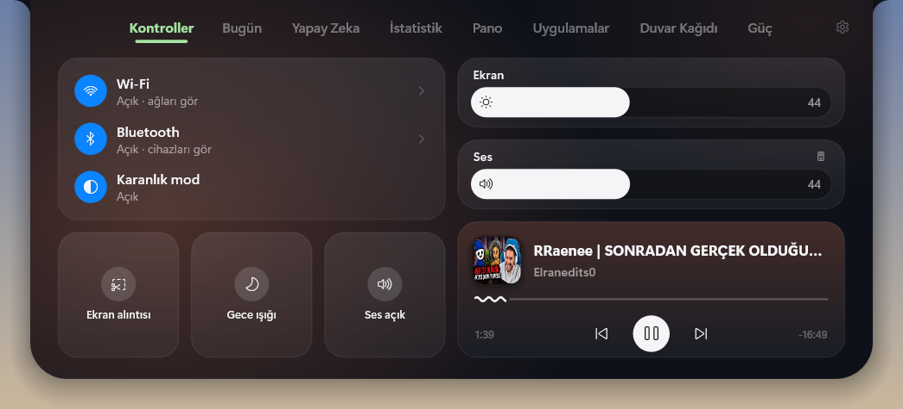
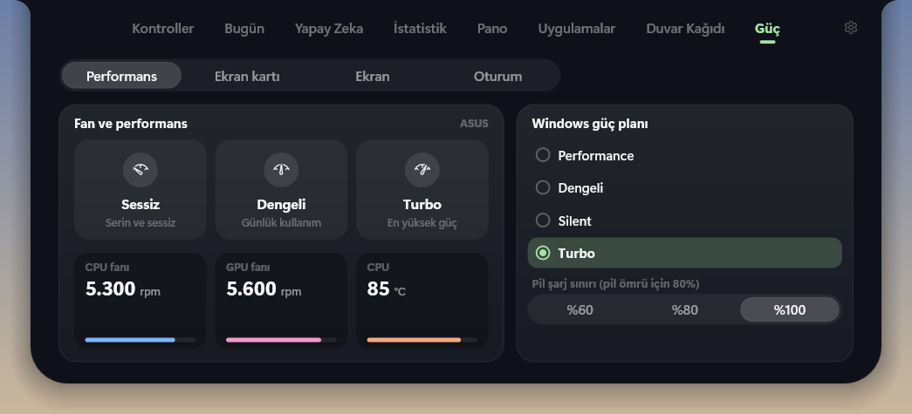
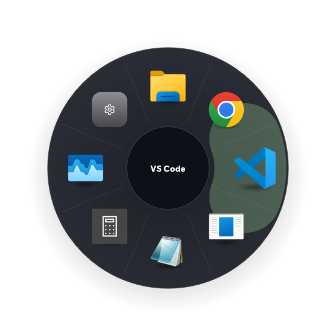
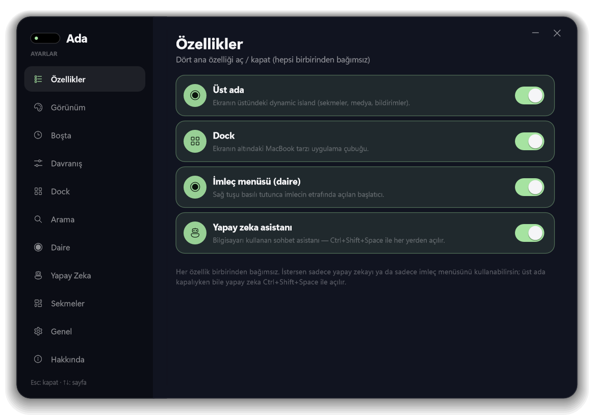
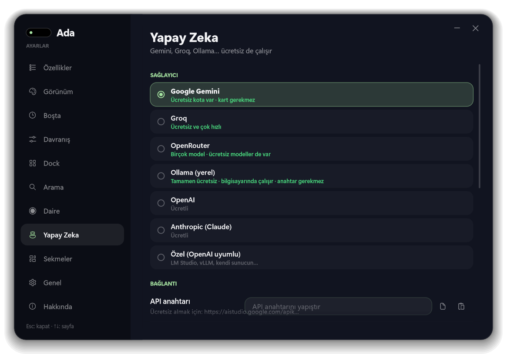

# Ada — Windows için MacBook deneyimi

**Ada**, Windows'a macOS tarzı bir arayüz kazandıran hafif bir masaüstü uygulamasıdır: üstte dynamic island, altta büyüteç efektli Dock, Spotlight araması, imlecin etrafında dairesel başlatıcı, Başlat menüsü tarzı uygulama paneli ve bilgisayarı gerçekten kullanabilen çok sağlayıcılı bir yapay zeka asistanı. Tek bir `.exe`, boşta yaklaşık **25–35 MB RAM**, GPU'suz yazılım render.

> C# / .NET 9 · Direct2D · bağımlılıksız (tek NuGet: Vortice.Direct2D1)

*(English summary below.)*

---



## Özellikler

Dört ana özellik **birbirinden tamamen bağımsız** — Ayarlar → Özellikler'den tek tek açıp kapatabilirsin.

- **Üst ada (dynamic island)** — ekranın üstünde, çentik ya da yüzen hap. Sekmeler: Kontroller, Bugün, İstatistik, Pano, Uygulamalar, Duvar Kağıdı, Güç, Yapay Zeka. Medya kontrolü, canlı bildirimler.
- **Dock** — MacBook tarzı alt çubuk: büyüteç efekti, zıplayan açılış, çalışma noktaları, DockDoor tarzı pencere önizlemeleri, buzlu cam.
- **İmleç menüsü (daire)** — sağ tuşu basılı tutunca imlecin etrafında açılan başlatıcı.
- **Yapay zeka asistanı** — Gemini / Groq / OpenRouter / Ollama / OpenAI / Anthropic (ücretsiz seçenekler dahil). Dosya düzenleme, çöp temizleme, güvenlik taraması, komut çalıştırma, internette arama ve (opt-in) ekranı görüp fare/klavye ile bilgisayarı kullanma.

Ayrıca: **Spotlight** araması (Ctrl+Space / Alt+Space / Windows tuşu), **Başlat menüsü tarzı uygulama paneli**, hesap makinesi, Launchy tarzı önekler (g / yt / w), Denetim Merkezi tarzı kontroller, Wi-Fi/Bluetooth listeleri, ayrıntılı **Güç** sekmesi (ASUS fan profili, GPU modu, ekran yenileme hızı, pil sınırı).

| | |
|---|---|
|  |  |
|  |  |
|  |  |

## Kurulum

1. [Releases](../../releases) sayfasından son sürümü indir (ya da aşağıdaki gibi derle).
2. `Ada.exe`'yi çalıştır. Başlat menüsüne "Ada" ve "Ada Ayarları" kısayolları eklenir.
3. **.NET 9 Masaüstü Runtime** gerekir (yoksa Windows yönlendirir). Tamamen taşınabilir istiyorsan `--self-contained true` ile derle.

Yapay zekayı kullanmak için Ayarlar → Yapay Zeka'dan bir sağlayıcı seç ve API anahtarını gir. **Ollama** seçersen hiç anahtar gerekmez, her şey bilgisayarında çalışır.

## Derleme

```bash
git clone https://github.com/<kullanıcı>/ada.git
cd ada
dotnet publish src/Ada -c Release -r win-x64 --self-contained false -o publish
# NativeAOT (daha az RAM, tek exe; Visual Studio "C++ ile masaüstü geliştirme" gerekir):
# dotnet publish src/Ada -c Release -r win-x64 -p:Aot=true -o publish-aot
dotnet test tests/Ada.Tests
```

## Kısayollar

| Kısayol | İşlev |
|---|---|
| Ctrl+Alt+Space | Üst adayı aç / kapat |
| Ctrl+Space (ayarlanabilir, Windows tuşu da olabilir) | Spotlight |
| Ctrl+Shift+Space | Yapay zeka penceresi |
| Alt+Q | İmleç menüsü (ya da sağ tuşu basılı tut) |

## Güvenlik notu

Yapay zeka asistanının yıkıcı işlemleri (dosya silme/yazma, komut çalıştırma, çalışma klasörü dışını okuma, Win kısayolları) **onay kutusundan geçer**. API anahtarların yalnızca bu bilgisayarda `%AppData%\Ada\state.json` içinde saklanır. Web araması yerel/özel adreslere erişemez (SSRF koruması).

## Mimari

Tek layered Win32 penceresi + Direct2D (yazılım) → UpdateLayeredWindow. Animasyon varken ekran yenilemesine kilitli, yokken tamamen uyur. Her yüzey (ada, dock, daire, spotlight, başlatıcı, ayarlar, yapay zeka) tek bir çizim motorunu paylaşır → düşük RAM. Ayrıntı: `docs/2026-10-13-ada-design.md`.

---

## English

**Ada** brings a macOS-style experience to Windows: a top dynamic island, a magnifying Dock, Spotlight search, a radial launcher around the cursor, a Start-menu-style app panel, and a multi-provider AI assistant that can actually operate your PC. Single `.exe`, ~25–35 MB idle RAM, software-rendered (no GPU required). C# / .NET 9 + Direct2D.

Four independent features (top island, Dock, radial menu, AI) — toggle each separately in Settings → Features. The AI works with **free options** (Google Gemini, Groq, local Ollama) as well as paid ones; destructive actions require confirmation, and API keys stay on your machine.

Build: `dotnet publish src/Ada -c Release -r win-x64 --self-contained false -o publish`

## Lisans / License

MIT — bkz. [LICENSE](LICENSE).
